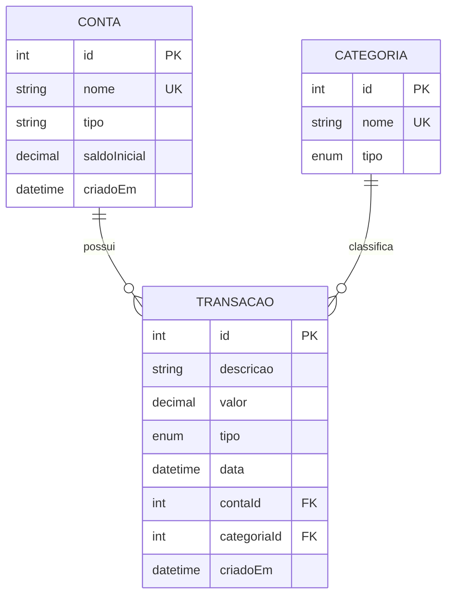

# Diagrama Entidade-Relacionamento (DER)

## Visão geral

O banco de dados do FinanSee possui três entidades principais:

- Conta
- Categoria
- Transacao

## Diagrama

## Entidades

### Conta

Representa uma conta financeira cadastrada pelo usuário.

Campos:

- `id`: identificador único.
- `nome`: nome da conta, não podendo se repetir.
- `tipo`: tipo da conta.
- `saldoInicial`: valor inicial da conta.
- `criadoEm`: data de criação do registro.

### Categoria

Organiza as transações por finalidade.

Campos:

- `id`: identificador único.
- `nome`: nome da categoria, não podendo se repetir.
- `tipo`: RECEITA ou DESPESA.

### Transacao

Representa uma movimentação financeira.

Campos:

- `id`: identificador único.
- `descricao`: descrição da movimentação.
- `valor`: valor financeiro.
- `tipo`: RECEITA ou DESPESA.
- `data`: data da movimentação.
- `contaId`: referência à conta.
- `categoriaId`: referência à categoria.
- `criadoEm`: data de criação do registro.

## Relacionamentos

### Conta e Transacao

Uma conta pode possuir várias transações.

Cada transação pertence a uma única conta.

**Cardinalidade:** 1:N.

### Categoria e Transacao

Uma categoria pode classificar várias transações.

Cada transação pertence a uma única categoria.

**Cardinalidade:** 1:N.

## Integridade dos dados

As chaves estrangeiras `contaId` e `categoriaId` relacionam as transações às respectivas contas e categorias.

O banco utiliza restrições para impedir que uma conta ou categoria vinculada a transações seja excluída sem tratar esses vínculos.

## Implementação

O modelo foi implementado utilizando Prisma ORM e PostgreSQL 16.

A definição das entidades está no arquivo `prisma/schema.prisma`.
